<h1 align="center">CHIRP Plus</h1>

<p align="center">
  <b>CHIRP with a cable it finds by itself, verified uploads and a terminal look.</b><br>
  A radio programmer for the 561 models CHIRP supports, tested on a UV-9R.
</p>

<p align="center">
  
  
  
  
</p>

<p align="center">
  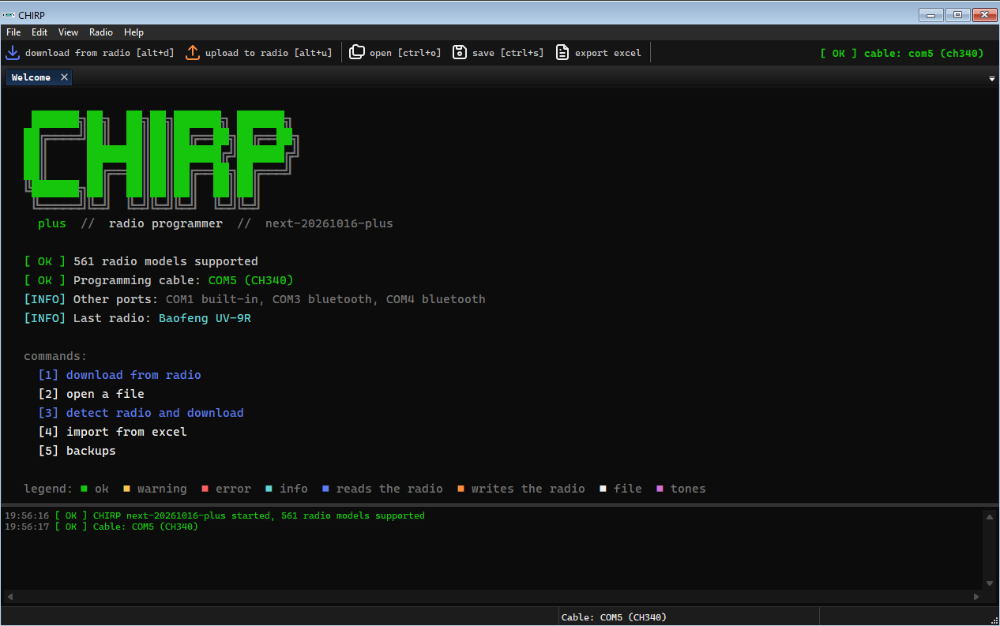
</p>

CHIRP Plus is a modified version of [CHIRP](https://chirpmyradio.com), the
free radio programmer. It keeps **every driver and feature of the
original**. On top of that it finds the cable and the radio by itself, shows
what will change before it writes to the radio, verifies the upload, and
adds tools for people who use radios in Italy.

> [!IMPORTANT]
> CHIRP Plus is an **unofficial customization project** that builds
> directly on the official CHIRP (`next-20261016`, upstream commit
> `832d349e`). It is not made or endorsed by the CHIRP project. The
> rights of the original authors and every license involved are respected:
> see [Relationship to CHIRP, rights and licenses](#relationship-to-chirp-rights-and-licenses).

<p align="center">
  <a href="#whats-new">What's new</a> ·
  <a href="#getting-started">Getting started</a> ·
  <a href="#italian-presets">Italian presets</a> ·
  <a href="#tested-on-real-hardware">Tested on real hardware</a> ·
  <a href="#development">Development</a> ·
  <a href="#relationship-to-chirp-rights-and-licenses">Rights and licenses</a>
</p>

---

## What's new

| | What it does | Where to find it |
|---|---|---|
| 🖥️ | **Terminal look**, where each color means the same thing everywhere | View > Look |
| 🔌 | **Automatic cable detection**: the chip is recognized, the port is chosen, counterfeit cables are flagged | download and upload dialogs |
| 📡 | **Detect radio**: asks the radio which model it is, without reading or writing its memory | Radio > Detect radio and download (Alt+R) |
| 🛡️ | **Safe upload**: compares with the radio before writing, verifies afterwards | upload dialog |
| 🧮 | **Spreadsheet-like editing**: select blocks of cells, drag the fill handle, Ctrl+D, copy and paste to and from Excel | the memory grid, right-click on the cells |
| 🔎 | **Every channel detail in the grid**: BCL, PTT-ID, S-Code and the other fields of Properties are columns | View > Show extra fields |
| 📻 | **Batch programming**: the same image into several radios, one after the other | Radio > Program several radios |
| 💾 | **Backups** of every download and every upload, with a compare view | File > Backups |
| ✅ | **Frequency check** against the Italian rules | Radio > Check frequencies |
| 🧩 | **Memory map** colored by function | Radio > Memory map |
| 🗂️ | **Pocket channel card** to print | File > Pocket channel card |
| 📊 | **Excel import/export** (`.xlsx`, and reading `.xls`) | File > Import / Export |
| 🇮🇹 | **Italian presets**: calling and simplex, 2 m and 70 cm repeaters, satellites, LPD and PMR446 | File > Open Stock Config |
| ⚙️ | **Settings profiles**: a team's radio settings applied in one go, after a review of every change (UV-5R and UV-9R) | Radio > Apply settings profile |
| 🌍 | **18 languages**: every new text is translated too | follows the Windows language |

### A terminal look, where colors mean something

A black background, monospace type, labels written like commands
(`download from radio [alt+d]`) and prompt-style headers
(`chirp@plus:~$ …`). Each color always means the same thing, in the grid,
in the event console and in the dialogs:

| Color | Meaning |
|---|---|
|  green | success, cable ready, verify passed |
|  yellow | warning |
|  red | error |
|  cyan | information, frequencies |
|  blue | **reads** from the radio |
|  orange | **writes** to the radio |
|  white | files |
|  magenta | tones and codes (CTCSS/DCS) |
|  gray | secondary, empty channels |

<p align="center">
  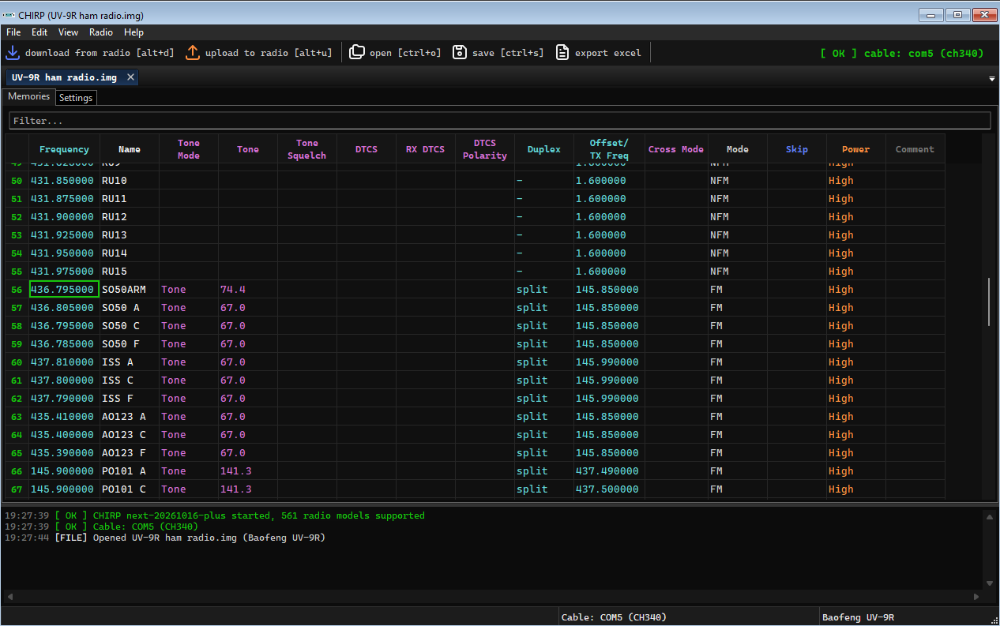
</p>

The grid colors each column by its function. At the bottom, the console
logs cables plugged in, downloads, uploads and verifies. The classic CHIRP
look is still one click away, in View > Look:

<p align="center">
  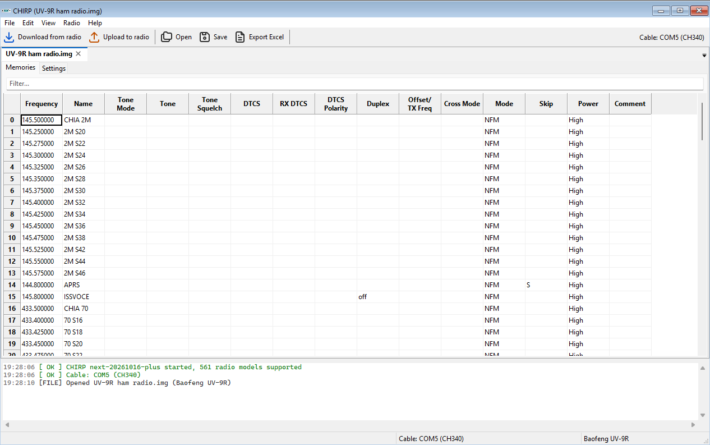
</p>

### Cable and radio found automatically

<table>
<tr>
<td width="50%">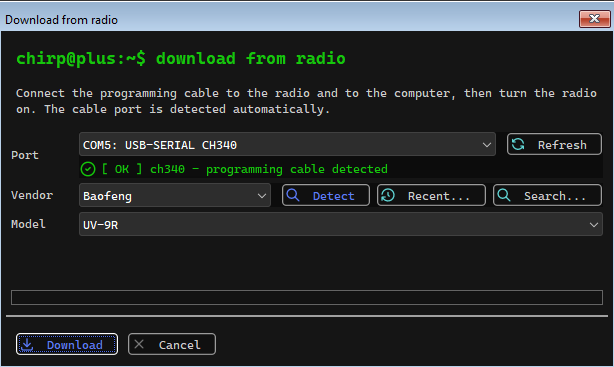</td>
<td>

- Recognizes cable chips from their USB ID (CH340/341/343, PL2303, FTDI,
  CP210x, STM32), lists them first and picks the right one. Bluetooth and
  built-in ports go to the bottom.
- **Hot-plug**: plug the cable in while the dialog is open and it gets
  selected straight away.
- Warns about counterfeit PL2303 chips and does not pick them: the current
  Windows driver refuses to work with them.
- **Detect** asks the radio for its model with the handshake alone. It
  never reads or writes the memory. If the model is compatible, the
  download happens in the same session.

</td>
</tr>
</table>

### Edit the channels like a spreadsheet

<p align="center">
  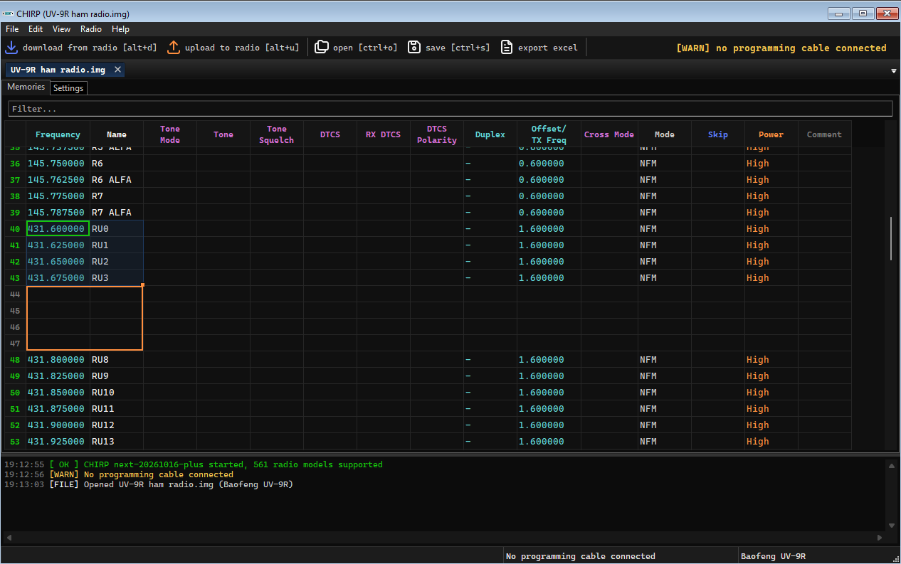
</p>

Select a block of cells and work on it as in Excel: drag the small square
at its corner down to copy the values or continue a series (145.500,
145.525 → 145.550…, CH01, CH02 → CH03…), press **Ctrl+D** to fill down,
**Ctrl+Enter** to write what you typed in every selected cell, **Delete**
to empty them. Copied cells paste straight into Excel, and tables copied
from Excel paste into the grid, decimal commas included. Right-click opens
*Series…* for a series with a chosen step. Each operation is one undo
step, the radio still checks every value, and one summary lists the cells
it refused. Filtered and sorted views only write to the rows you see.
Formulas and filling to the right are not supported.

The per-channel details that CHIRP shows only in right-click > Properties
(busy channel lockout, PTT-ID, S-Code…) are grid columns too, before the
comment, and edit like the others. View > Show extra fields hides them.

### Settings profiles

<p align="center">
  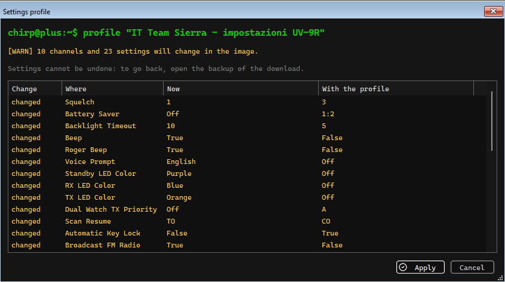
</p>

Radio > Apply settings profile sets a whole team's radio settings in one
go on a downloaded image: first a list of every setting and channel that
will change, with what will be skipped, then Apply. Only what changes is
written. Profiles for the UV-5R and the UV-9R come with the "IT Team
Sierra" preset; *From file…* applies your own JSON profile.

### Safe upload

Before writing, CHIRP Plus reads the radio and shows **what will change**,
channel by channel: added in green, removed in red, changed in yellow.
After the upload it reads the radio back and compares, byte by byte, the
areas the driver wrote.

<table>
<tr>
<td width="40%">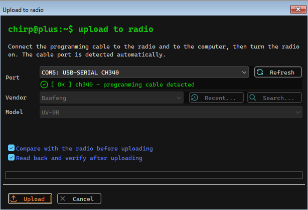</td>
<td>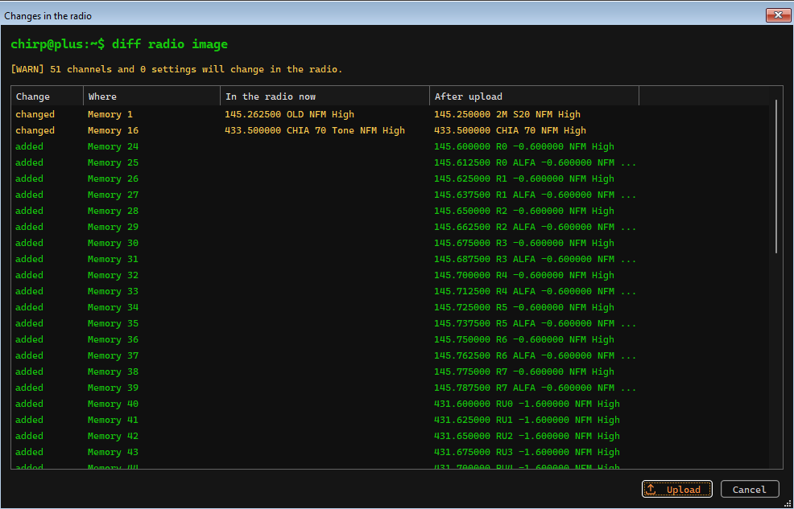</td>
</tr>
</table>

### Several radios, backups and checks

<table>
<tr>
<td width="50%">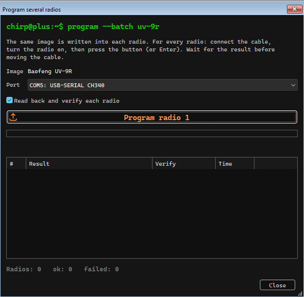</td>
<td>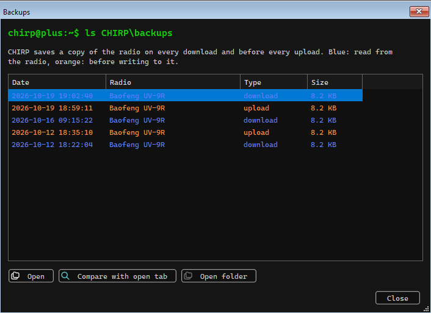</td>
</tr>
<tr>
<td><b>Batch programming</b>: the same image into several radios, one after
the other (button or Enter), with a verify, a result for each radio and
totals. Handy when a group wants the same channels.</td>
<td><b>Backups</b>: a copy on every download and before every upload. Any
backup can be opened, or compared with the open tab.</td>
</tr>
<tr>
<td>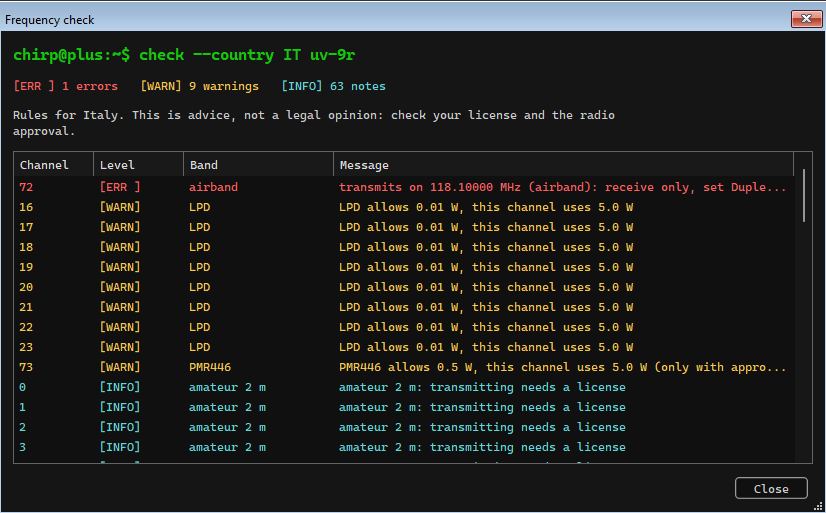</td>
<td>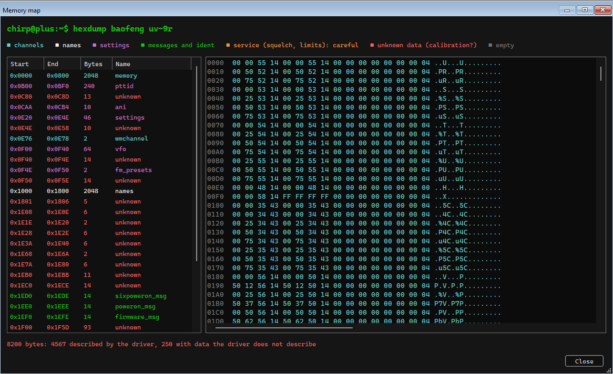</td>
</tr>
<tr>
<td><b>Frequency check</b> against the Italian rules: transmitting on
receive-only bands, bands that need a license, power above the LPD (10 mW)
and PMR446 (0.5 W) limits. It is advice, not a legal opinion.</td>
<td><b>Memory map</b>: the hex dump colored by function (channels, names,
settings, messages). It also shows the areas the driver does not describe,
such as calibration data.</td>
</tr>
</table>

### Pocket channel card

<p align="center">
  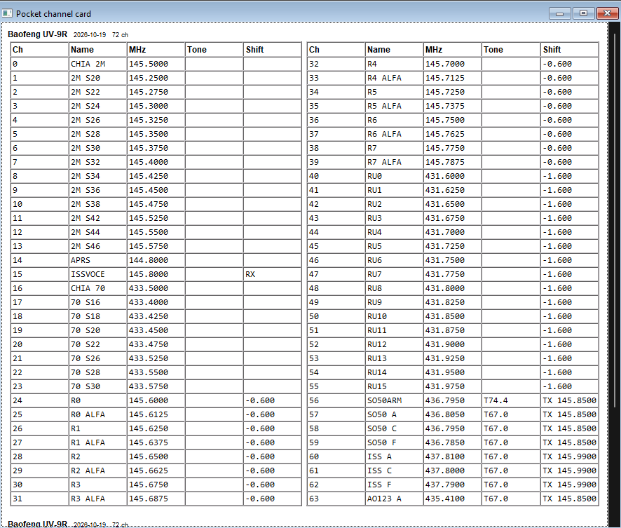
</p>

An A4 print preview in two columns, with channel, name, frequency, tone and
shift, to keep with the radio.

### 18 languages

All the new texts (213 of them) are translated into the 17 CHIRP
languages, plus English as the source. Each language uses the terms its
official translation already used. The app follows the Windows language.

## Getting started

1. Download `CHIRP-Plus.exe` from the
   [Releases](https://github.com/sacchetti84-dev/chirp-plus/releases)
   page (no installation needed) and run it. Windows SmartScreen may warn
   that the file is not signed: choose *More info > Run anyway*.
2. Connect the cable to the radio and to the computer, then turn the radio
   on.
3. Press **download from radio** (Alt+D) or **detect radio and download**
   (Alt+R). The cable port is already selected.
4. Edit the channels, or start from a preset: File > Open Stock Config.
5. Press **upload to radio** (Alt+U), check the list of changes and
   confirm. At the end CHIRP Plus verifies that the radio really holds the
   uploaded image.

CHIRP Plus uses the same settings as the official CHIRP
(`%APPDATA%\CHIRP`), so the two programs can live side by side.

## Italian presets

Open them from File > Open Stock Config, then copy the channels into the
radio tab, or import them with File > Import from file. The preset names
and the channel comments are in Italian.

| Preset | Channels | Contents |
|---|---:|---|
| IT Chiamata e simplex radioamatori | 24 | calling 145.500 / 433.500, 2 m and 70 cm simplex, APRS, ISS voice |
| IT Ponti ripetitori 2 m | 16 | R0–R7 and the "alfa" channels (RV48–RV63), −600 kHz shift |
| IT Ponti ripetitori 70 cm | 16 | RU0–RU15, output 431.600–431.975, −1.6 MHz shift |
| IT Satelliti FM radioamatori | 16 | SO-50 (with the timer arming channel), ISS, AO-123, PO-101, AO-91: split with CTCSS and three Doppler steps |
| IT Radioamatori tutto in uno | 72 | all of the above together, fits the 128 memories of a UV-9R |
| IT LPD e PMR446 | 85 | 69 LPD and 16 PMR446 channels at their legal power |
| IT Team Sierra | 95 | SIERRA 1–10 team channels (2 m simplex on little-used 12.5 kHz channels, one DCS code each, amateur license needed), plus the standard PMR446 1–16 and LPD 1–69 channels at the lowest power, to talk to licence-free teams (those bands are for approved radios only: each channel's comment says so). Comes with **settings profiles** for the UV-5R and the UV-9R (Radio > Apply settings profile): squelch, LEDs and beeps off, dual watch, busy-channel lockout, channel mode, no PTT-ID |

> [!NOTE]
> Transmitting on 2 m and 70 cm needs an amateur radio license. LPD and
> PMR446 need no license, but only with approved radios: the UV-9R is not
> one, and its lowest power is 1 W. The access tone of a repeater (1750 Hz
> or CTCSS) differs from one repeater to the next, so add it yourself.
> Satellites can go silent: check the
> [AMSAT table](https://www.amsat.org/live-fm-satellites/) before a pass.

## Tested on real hardware

On a real **UV-9R** with a CH340 cable on COM5:

- model detection and download in the same session, with the same result
  as a normal download;
- compare before upload (read commands only);
- upload of the very image the radio already held: written successfully,
  verify with 0 differences over the 8 KB;
- import of every preset: frequencies, shifts, splits and tones stay
  intact.

911 automated tests pass as well.

## Development

You need Python 3.14 and wxPython 4.3:

```bash
python -m venv .venv
.venv\Scripts\pip install -e .[wx] pyinstaller polib pytest pytest-xdist
.venv\Scripts\python chirpwx.py                        # run from source
.venv\Scripts\python -m pytest tests\unit -n 8         # tests
.venv\Scripts\python tools\build_windows.py            # folder build + ZIP
.venv\Scripts\python tools\build_windows.py --onefile  # shareable CHIRP-Plus.exe
.venv\Scripts\python tools\sync_upstream.py            # what is new in official CHIRP
```

Maintenance scripts:

| Script | What it does |
|---|---|
| `tools/make_ham_presets.py` | regenerates the Italian presets (repeaters, satellites, LPD/PMR) |
| `tools/add_translations.py` | adds the translations in `tools/translations/*.json` to the catalogs |
| `tools/screenshots.py` | retakes the pictures on this page, from a demo image |
| `tools/sync_upstream.py` | compares with, and merges, the official CHIRP commits |

The technical notes on each change, in Italian, are in
[README-PLUS.md](../README-PLUS.md).

## Relationship to CHIRP, rights and licenses

CHIRP Plus is a customization of [CHIRP](https://chirpmyradio.com) and
refers directly to the official version: it starts from CHIRP
`next-20261016` (upstream commit
[`832d349e`](https://github.com/kk7ds/chirp/commit/832d349e)), keeps all of
its drivers and features, and can take in new official commits with
`tools/sync_upstream.py`. It is **not an official CHIRP release** and is
not made, reviewed or endorsed by the CHIRP project.

This is how CHIRP Plus respects the rights of the original authors and
the licenses involved, as checked file by file:

| Obligation | How CHIRP Plus meets it |
|---|---|
| Same license as CHIRP | CHIRP Plus is free software under the [GNU GPL version 3](../COPYING) or later, the license of CHIRP, without any warranty. |
| Original copyright kept | Every copyright and license notice of the CHIRP files is unchanged. The new files say *Copyright 2026 CHIRP Plus contributors* and carry the same GPL notice. |
| Changes marked, with a date (GPLv3 §5a) | [`NOTICE`](../NOTICE), the About window and the first-run license window say that this is a modified version and what it is based on; the git history lists every change with its date. |
| Legal notices in the program (GPLv3 §5d) | The About window, also shown at first start, gives the copyright, the license and the absence of warranty. |
| Complete source (GPLv3 §6) | The whole source, with the build scripts, is in this repository and, for whoever receives the program, in `CHIRP-Plus-sorgente.zip`, inside the share package and on the release page. |
| Third-party software in the executable | Python, wxPython, requests, openpyxl and the other bundled libraries keep their own licenses (MIT, BSD, Apache, PSF, MPL, LGPL). Their notices are inside the program and next to it in `THIRD-PARTY-NOTICES.txt`, generated by the build from the exact list of bundled files. The source of the LGPL and MPL ones is in `CHIRP-Plus-librerie-sorgente.zip`. |
| Icons | [Tabler Icons](https://tabler.io/icons), MIT license, with its license file in `chirp/share/icons`. |
| The CHIRP name | "CHIRP" is the name of the original project. CHIRP Plus uses it only to say what it is based on, and never presents itself as the official program. |
| The services of the CHIRP project | CHIRP Plus sends no usage statistics to the official server, and *Help > Report or update a bug* opens the issues of this repository instead of the official tracker. It still asks the official server, read-only, whether a new official CHIRP version exists. |

<p align="center">
  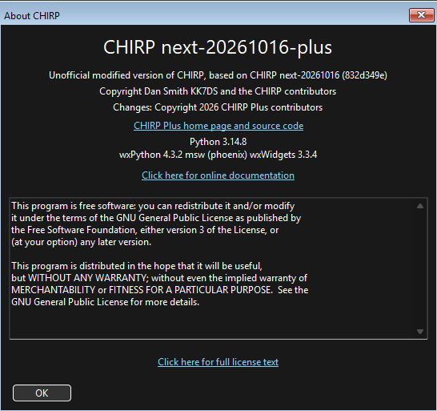
</p>

Report problems with CHIRP Plus [here](https://github.com/sacchetti84-dev/chirp-plus/issues),
not to the CHIRP project.

**Credits**: CHIRP is © Dan Smith KK7DS and the CHIRP contributors. The
changes are © 2026 the CHIRP Plus contributors.
